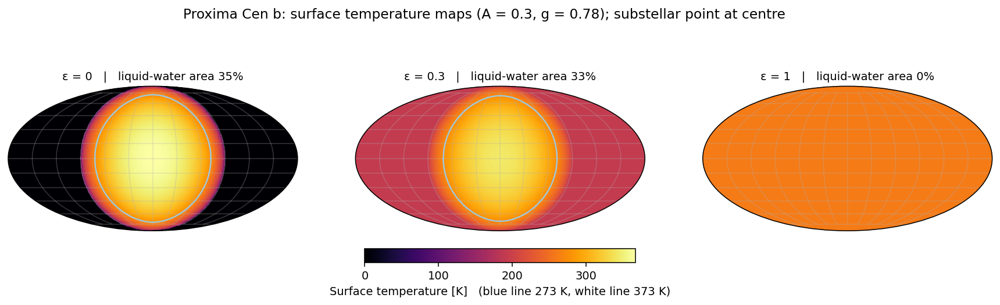
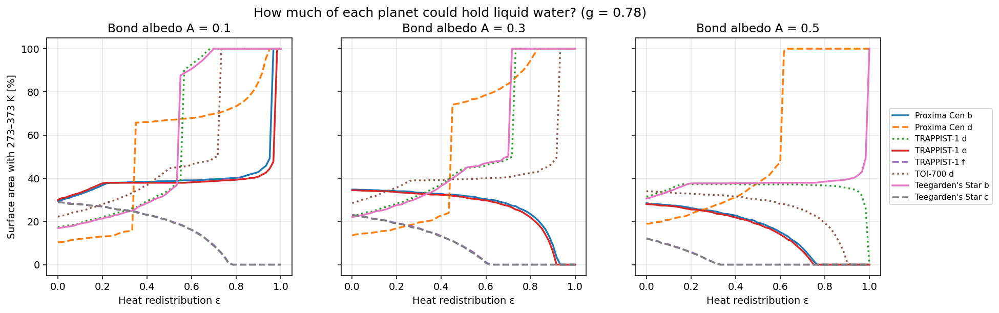
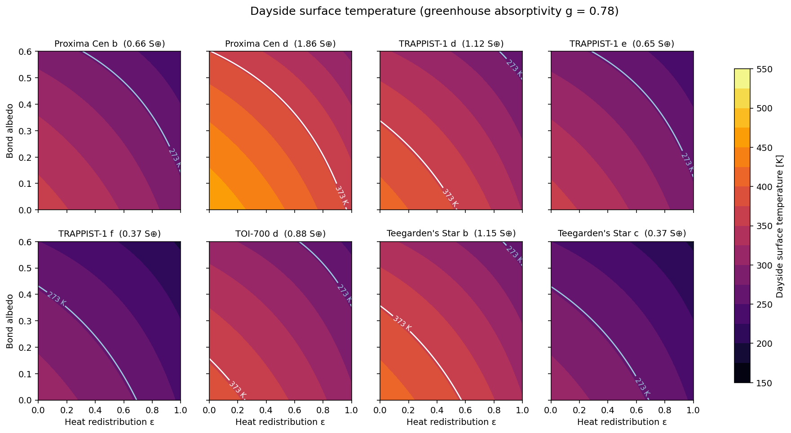
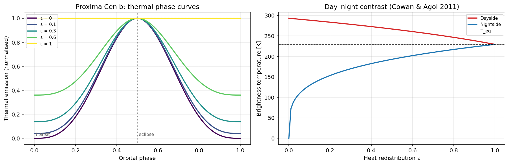

#  Exoplanet Temperature Maps


Energy-balance models of the **surface temperature of rocky exoplanets**, applied to the nearest potentially habitable worlds: Proxima Centauri b and d, TRAPPIST-1 d, e and f, TOI-700 d and Teegarden's Star b and c. The code produces **surface temperature maps** of tidally locked planets, estimates **how much of each surface could hold liquid water**, and predicts the **thermal phase curves** that telescopes like JWST use to measure heat transport.


*Proxima Centauri b with weak (ε = 0), moderate (ε = 0.3) and full (ε = 1) heat transport. The blue contour marks 273 K. With weak heat transport, a temperate "eyeball" faces the star. When heat is spread evenly, the whole planet sits below freezing.*

---

## The model

The model has three free parameters: the **Bond albedo** *A*, the **heat-redistribution efficiency** ε (0 = bare rock, 1 = uniform temperature), and the **greenhouse absorptivity** *g* of the atmosphere (0 = airless, 1 = opaque in the infrared).

| Quantity | Expression | Reference |
|---|---|---|
| Insolation | $S = S_\oplus\,L_\star / a^2$ | |
| Equilibrium temperature | $T_{\rm eq}^4 = S(1-A)/4\sigma$ | |
| Dayside / nightside temperature | $T_{\rm day}^4 = \frac{S}{\sigma}(1-A)\left(\frac{2}{3}-\frac{5\varepsilon}{12}\right)$, $\;T_{\rm night}^4 = \frac{S}{\sigma}(1-A)\frac{\varepsilon}{4}$ | Cowan & Agol (2011) |
| Greenhouse warming | $T_s = T_e\left(\frac{2}{2-g}\right)^{1/4}$ (single-layer grey atmosphere) | e.g. Catling & Kasting (2017) |
| Surface map | $\sigma T^4(\phi,\lambda) = S(1-A)\left[(1-\varepsilon)\max(\cos Z,0) + \varepsilon/4\right]$ | |

The surface map conserves energy exactly. Its disk-integrated dayside brightness reproduces the Cowan & Agol dayside temperature for every ε, and both properties are checked by the tests. As a validation, Earth (*A* = 0.3, *g* = 0.78) comes out at **255 K** without and **288 K** with its greenhouse effect, matching the observed mean.

## Results

For Bond albedo 0.3 and an Earth-like greenhouse (*g* = 0.78):

| Planet | Insolation (S⊕) | T_eq (K) | Global surface T (K) | Bare-rock dayside T (K) | Liquid-water area at ε = 0.3 |
|---|---|---|---|---|---|
| Earth | 1.00 | 255 | 288 | — | — |
| Proxima Cen b | 0.66 | 229 | 260 | 293 | 33 % |
| Proxima Cen d | 1.86 | 297 | 337 | 380 | 19 % |
| TRAPPIST-1 d | 1.12 | 262 | 296 | 334 | 32 % |
| TRAPPIST-1 e | 0.65 | 228 | 258 | 292 | 33 % |
| TRAPPIST-1 f | 0.37 | 199 | 225 | 254 | 17 % |
| TOI-700 d | 0.88 | 246 | 279 | 315 | 39 % |
| Teegarden's Star b | 1.15 | 264 | 298 | 337 | 31 % |
| Teegarden's Star c | 0.37 | 199 | 225 | 254 | 17 % |

**Main finding:** for the temperate M-dwarf planets, **heat transport matters as much as the amount of starlight they receive**. Proxima b and TRAPPIST-1 e keep about a third of their surface between 273 and 373 K while heat transport is weak, but freeze over completely when it becomes efficient. Warmer planets such as TRAPPIST-1 d and Teegarden's Star b do the opposite: they become entirely temperate when heat is shared evenly.



### Dayside temperature across albedo and heat transport



### Observable signature: thermal phase curves

A planet with weak heat transport is bright at secondary eclipse and dark at transit, so the shape of its phase curve measures ε.



## Installation and usage

```bash
git clone https://github.com/Jiqbal-astro/exoplanet-temperature-maps.git
cd exoplanet-temperature-maps
pip install -r requirements.txt
```

To produce every figure and the summary table in `figures/`, run:

```bash
python exotemp.py
python exotemp.py --albedo 0.2 --greenhouse 0.6 --map-planet "TRAPPIST-1 e"
```

You can also use it as a library:

```python
import exotemp as et

S = et.insolation(luminosity=0.00155, a_au=0.0485)          # Proxima b, W/m²
et.dayside_temperature(S, albedo=0.3, eps=0.0)              # bare-rock dayside
T, lat, lon, area = et.temperature_map(S, 0.3, eps=0.3, g=0.78)
et.liquid_water_fraction(T, area)
```

The notebook [`exoplanet_temperature_maps.ipynb`](exoplanet_temperature_maps.ipynb) walks through the full analysis. To add a planet, add a row to `data/planets.csv`.

| Option | Default | Description |
|---|---|---|
| `--albedo` | `0.3` | Bond albedo for the maps and the table |
| `--greenhouse` | `0.78` | Infrared absorptivity *g* (0 = no atmosphere, 1 = opaque) |
| `--map-planet` | `Proxima Cen b` | Planet used for the maps and phase curves |
| `--planets` | `data/planets.csv` | Planet catalogue |
| `-o, --output` | `figures` | Output directory |

**Testing:** run `pip install pytest && pytest`. The 17 tests check the model against Earth's temperatures, energy conservation, the Cowan & Agol limits, and published insolations and equilibrium temperatures.

## Limitations

These are energy-balance estimates, not climate simulations. They leave out:

- atmospheric and ocean dynamics (3D models give smoother day–night contrasts),
- clouds and the ice–albedo feedback,
- the red spectrum of M dwarfs, which lowers the effective albedo of ice and snow,
- atmospheric loss driven by stellar flares and winds.

The grey greenhouse is applied with the same strength everywhere, and orbits are taken as circular.

## References

- Cowan, N. B. & Agol, E. (2011), *The statistics of albedo and heat recirculation on hot exoplanets*, ApJ, 729, 54
- Catling, D. C. & Kasting, J. F. (2017), *Atmospheric Evolution on Inhabited and Lifeless Worlds*, Cambridge University Press
- Anglada-Escudé, G. et al. (2016), Nature, 536, 437 (Proxima b)
- Faria, J. P. et al. (2022), A&A, 658, A115 (Proxima d)
- Agol, E. et al. (2021), PSJ, 2, 1 (TRAPPIST-1)
- Gilbert, E. A. et al. (2020), AJ, 160, 116 (TOI-700 d)
- Zechmeister, M. et al. (2019), A&A, 627, A49 (Teegarden's Star)
- Kopp, G. & Lean, J. L. (2011), GRL, 38, L01706 (solar constant)

## Related

The habitable-zone boundaries of these same systems are in [Habitable-Zone-Analysis](https://github.com/Jiqbal-astro/Habitable-Zone-Analysis).

## Author

**Javed Iqbal**: astronomy researcher working on exoplanets and variable stars
[GitHub](https://github.com/Jiqbal-astro) · [Website](https://jiqbal-astro.github.io) · [LinkedIn](https://www.linkedin.com/in/jiqbal-astro/)

Released under the [MIT License](LICENSE).
